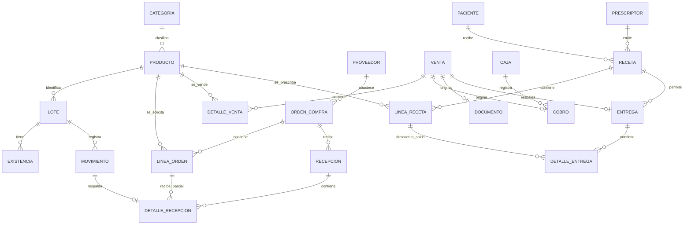

# Revisión del esquema de Farmacia en PostgreSQL

**19/11/2026.** Se consultó la base local `farmacia` en PostgreSQL 17.11 después de aplicar las migraciones. Se encontraron 50 tablas en total, de las cuales 40 pertenecen a los módulos del proyecto.

| Elemento de las tablas del proyecto | Resultado |
|---|---:|
| Claves primarias | 40 |
| Claves foráneas | 63 |
| Restricciones UNIQUE distintas de la PK | 27 |
| Restricciones CHECK | 40 |
| Índices físicos, incluidos los de PK y unicidad | 132 |
| FK sin índice válido y no parcial que comience por su columna | 0 |

El [diccionario físico](diccionario-postgresql.md) lista columnas, tipos, nulabilidad, restricciones e índices consultados en PostgreSQL. El conteo de restricciones UNIQUE distingue los índices únicos parciales, que aparecen como índices en el diccionario.

## Relaciones principales



El esquema separa entidades de referencia, transacciones y partidas. Una recepción remite a su orden y sus partidas permiten registrar entregas parciales. La disponibilidad se desglosa por lote y ubicación. Los nombres y precios copiados a una partida de venta y la instantánea de una entrega preservan lo registrado aunque cambien los datos de referencia. Estas copias históricas tienen una finalidad distinta a la ficha actual del producto o del paciente.

## Medición

Se ejecutaron 20 muestras tras un calentamiento, con un cliente y una base temporal migrada desde cero. La carga fue de 10.000 productos, 10.000 ventas y 10.000 detalles de venta. El filtro de fecha seleccionó 1.000 ventas. Los tiempos son de ejecución SQL informados por PostgreSQL mediante `EXPLAIN ANALYZE`, excluyen el tiempo del navegador y no representan una prueba de estrés. [Referencia de EXPLAIN](https://www.postgresql.org/docs/17/using-explain.html).

| Consulta | p95 observado | Hallazgo |
|---|---:|---|
| Búsqueda parcial de catálogo, muestra selectiva | 3,926 ms | Usa el índice de código para el recorrido ordenado. La coincidencia parcial sigue siendo un filtro. |
| Igualdad aislada por código de barras | 0,018 ms | Usa un índice existente. Esta consulta aislada no mide el buscador POS completo. |
| Partidas agrupadas por producto, filtro por fecha local | 3,924 ms | PostgreSQL usa lecturas secuenciales para el conjunto medido. |
| Mismo agrupamiento, filtro por intervalo horario | 1,768 ms | Entregó el mismo total bruto verificado. Utiliza inicio de día inclusivo y comienzo del día siguiente exclusivo en la zona de la aplicación. |

Se mantienen los índices existentes. Para los futuros indicadores de la API conviene probar el filtro por intervalo con casos en los límites del día y cambios de horario antes de adoptarlo. Volver a medir búsquedas y reportes con datos más variados y carga concurrente cuando esté lista la API.

[Resultados, muestras y planes de ejecución](medicion-postgresql.json).

Para repetir desde `backend/` con el entorno Python activado y PostgreSQL iniciado:

```powershell
python -B scripts/revisar_esquema.py . ../docs/esquema
```
