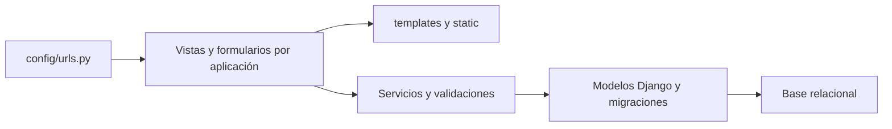
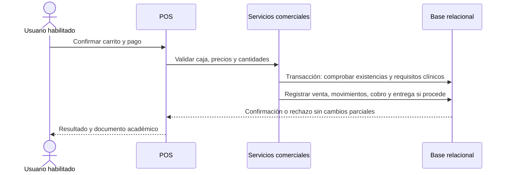
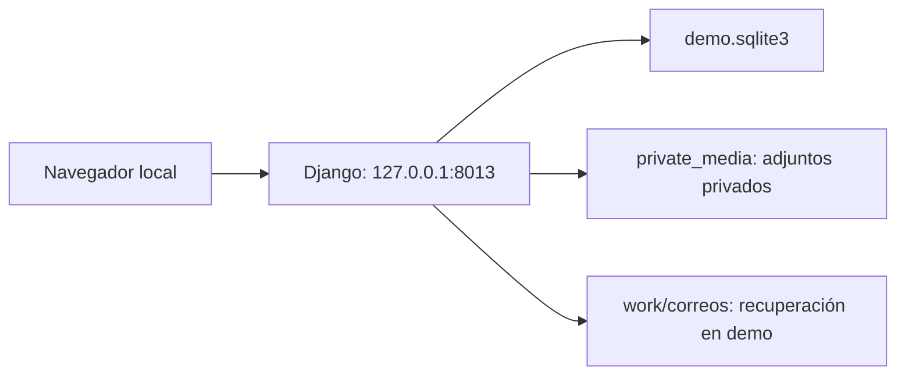

# Arquitectura 4+1 de la versión ampliada

Estado local documentado: 20 de octubre de 2026. Django con páginas HTML renderizadas en servidor, CSS y JavaScript; ORM relacional. La demostración comprobada usa SQLite. La configuración normal contempla PostgreSQL, cuyo despliegue no está acreditado por esta revisión.

## Vista lógica

| Aplicación | Responsabilidad |
|---|---|
| catalogo | Productos, categorías, referencias e historial del catálogo. |
| operaciones | Lotes, existencias, movimientos, ventas, panel y reportes. |
| compras | Proveedores, órdenes y recepciones. |
| seguridad | Acceso, recuperación, límites de intentos e inactividad. |
| clinica | Pacientes, prescriptores, recetas, adjuntos privados, entregas y controlados. |
| comercio | Caja, POS, cobros, convenios y documentos académicos. |
| gestion | Trabajadores/roles, precios, condiciones, alertas y consulta de auditoría. |

## Vista de desarrollo

Los permisos se configuran en catalogo/management/commands/configurar_roles.py. Los servicios contienen reglas que no deben depender solo de ocultar botones.

## Vista de procesos

La venta usa selección de lotes FEFO e idempotencia. Los documentos tienen su propio estado y reintentos. La concurrencia con bloqueos debe validarse en PostgreSQL; SQLite no acredita esos bloqueos.

## Vista física

Este es un entorno académico local. PostgreSQL y SMTP son configuraciones previstas para otro entorno, no servicios demostrados aquí. Los adjuntos se descargan a través de una vista con permisos; no tienen una ruta pública de media. No hay integración tributaria real ni base documental independiente acreditada.

## +1: escenarios

1. Compra → recepción parcial → existencias por lote → traslado.
2. Apertura de caja → POS → venta/cobro → documento académico → cierre.
3. Receta → revisión farmacéutica → autorización si corresponde → venta y entrega → orden imprimible.
4. Administración → configuración de precio/alerta o rol → consulta de auditoría.

Consultar el [diccionario generado de modelos](diccionario-datos.md), la [seguridad aplicada](seguridad-aplicada.md) y la [checklist](checklist-demostracion.md).
