# Diccionario de datos de la versión ampliada

Generado el 20 de octubre de 2026 a partir de modelos Django, sin modificar la base. Incluye tipos lógicos, PK, nulabilidad, unicidad y relaciones. No sustituye comprobar migraciones y restricciones en el servidor de entrega.

Modelos de negocio: **40**. Las tablas estándar de autenticación, grupos, permisos y sesiones pertenecen a Django y no se incluyen en este recuento. JSONField es un campo de la base relacional, no otro motor de base de datos.

## Relaciones entre modelos

```mermaid
flowchart LR
  catalogo_Categoria["catalogo.Categoria"]
  catalogo_EventoCatalogo["catalogo.EventoCatalogo"]
  catalogo_EventoCatalogo -->|producto| catalogo_Producto
  catalogo_EventoCatalogo -->|usuario| auth_User
  catalogo_PrecioReferencia["catalogo.PrecioReferencia"]
  catalogo_PrecioReferencia -->|producto| catalogo_Producto
  catalogo_Producto["catalogo.Producto"]
  catalogo_Producto -->|categoria| catalogo_Categoria
  clinica_AdjuntoReceta["clinica.AdjuntoReceta"]
  clinica_AdjuntoReceta -->|receta| clinica_Receta
  clinica_AdjuntoReceta -->|usuario| auth_User
  clinica_AdjuntoReceta -->|revisado_por| auth_User
  clinica_AsientoControlado["clinica.AsientoControlado"]
  clinica_AsientoControlado -->|entrega| clinica_Entrega
  clinica_AsientoControlado -->|producto| catalogo_Producto
  clinica_AsientoControlado -->|profesional| auth_User
  clinica_AsientoControlado -->|compensa| clinica_AsientoControlado
  clinica_AutorizacionControlado["clinica.AutorizacionControlado"]
  clinica_AutorizacionControlado -->|receta| clinica_Receta
  clinica_AutorizacionControlado -->|producto| catalogo_Producto
  clinica_AutorizacionControlado -->|profesional| auth_User
  clinica_AutorizacionControlado -->|entrega| clinica_Entrega
  clinica_DetalleEntrega["clinica.DetalleEntrega"]
  clinica_DetalleEntrega -->|entrega| clinica_Entrega
  clinica_DetalleEntrega -->|linea_receta| clinica_LineaReceta
  clinica_Entrega["clinica.Entrega"]
  clinica_Entrega -->|receta| clinica_Receta
  clinica_Entrega -->|venta| operaciones_Venta
  clinica_Entrega -->|usuario| auth_User
  clinica_Entrega -->|retirante| clinica_Paciente
  clinica_EventoClinico["clinica.EventoClinico"]
  clinica_EventoClinico -->|receta| clinica_Receta
  clinica_EventoClinico -->|usuario| auth_User
  clinica_LineaReceta["clinica.LineaReceta"]
  clinica_LineaReceta -->|receta| clinica_Receta
  clinica_LineaReceta -->|producto| catalogo_Producto
  clinica_Paciente["clinica.Paciente"]
  clinica_Prescriptor["clinica.Prescriptor"]
  clinica_Receta["clinica.Receta"]
  clinica_Receta -->|paciente| clinica_Paciente
  clinica_Receta -->|prescriptor| clinica_Prescriptor
  clinica_Receta -->|revisada_por| auth_User
  comercio_Caja["comercio.Caja"]
  comercio_Caja -->|usuario| auth_User
  comercio_Cobro["comercio.Cobro"]
  comercio_Cobro -->|venta| operaciones_Venta
  comercio_Cobro -->|caja| comercio_Caja
  comercio_Cobro -->|convenio| comercio_Convenio
  comercio_Convenio["comercio.Convenio"]
  comercio_Documento["comercio.Documento"]
  comercio_Documento -->|venta| operaciones_Venta
  comercio_EventoComercial["comercio.EventoComercial"]
  comercio_EventoComercial -->|usuario| auth_User
  comercio_MovimientoCaja["comercio.MovimientoCaja"]
  comercio_MovimientoCaja -->|caja| comercio_Caja
  compras_DetalleRecepcion["compras.DetalleRecepcion"]
  compras_DetalleRecepcion -->|recepcion| compras_Recepcion
  compras_DetalleRecepcion -->|linea| compras_LineaOrden
  compras_DetalleRecepcion -->|movimiento| operaciones_Movimiento
  compras_EventoCompra["compras.EventoCompra"]
  compras_EventoCompra -->|orden| compras_OrdenCompra
  compras_EventoCompra -->|usuario| auth_User
  compras_EventoProveedor["compras.EventoProveedor"]
  compras_EventoProveedor -->|proveedor| compras_Proveedor
  compras_EventoProveedor -->|usuario| auth_User
  compras_LineaOrden["compras.LineaOrden"]
  compras_LineaOrden -->|orden| compras_OrdenCompra
  compras_LineaOrden -->|producto| catalogo_Producto
  compras_OrdenCompra["compras.OrdenCompra"]
  compras_OrdenCompra -->|proveedor| compras_Proveedor
  compras_OrdenCompra -->|usuario| auth_User
  compras_Proveedor["compras.Proveedor"]
  compras_Recepcion["compras.Recepcion"]
  compras_Recepcion -->|orden| compras_OrdenCompra
  compras_Recepcion -->|usuario| auth_User
  gestion_ConfiguracionAlerta["gestion.ConfiguracionAlerta"]
  gestion_ConfiguracionAlerta -->|producto| catalogo_Producto
  gestion_EventoGestion["gestion.EventoGestion"]
  gestion_EventoGestion -->|usuario| auth_User
  gestion_PoliticaPrecio["gestion.PoliticaPrecio"]
  gestion_PoliticaPrecio -->|producto| catalogo_Producto
  gestion_PrecioProgramado["gestion.PrecioProgramado"]
  gestion_PrecioProgramado -->|producto| catalogo_Producto
  gestion_PrecioProgramado -->|usuario| auth_User
  gestion_Trabajador["gestion.Trabajador"]
  gestion_Trabajador -->|usuario| auth_User
  operaciones_DetalleVenta["operaciones.DetalleVenta"]
  operaciones_DetalleVenta -->|venta| operaciones_Venta
  operaciones_DetalleVenta -->|producto| catalogo_Producto
  operaciones_EventoReporte["operaciones.EventoReporte"]
  operaciones_EventoReporte -->|usuario| auth_User
  operaciones_Existencia["operaciones.Existencia"]
  operaciones_Existencia -->|lote| operaciones_Lote
  operaciones_Lote["operaciones.Lote"]
  operaciones_Lote -->|producto| catalogo_Producto
  operaciones_Movimiento["operaciones.Movimiento"]
  operaciones_Movimiento -->|lote| operaciones_Lote
  operaciones_Movimiento -->|usuario| auth_User
  operaciones_Movimiento -->|detalle_venta| operaciones_DetalleVenta
  operaciones_Venta["operaciones.Venta"]
  operaciones_Venta -->|usuario| auth_User
  seguridad_EventoAcceso["seguridad.EventoAcceso"]
  seguridad_LimiteAcceso["seguridad.LimiteAcceso"]
```

## Campos y restricciones

### catalogo.Categoria

Tabla: `catalogo_categoria`.

| Campo | Tipo | Nulo | Clave / relación |
|---|---|---|---|
| id | BigAutoField | No | PK |
| nombre | CharField(80) | No | Único |

### catalogo.EventoCatalogo

Tabla: `catalogo_eventocatalogo`.

| Campo | Tipo | Nulo | Clave / relación |
|---|---|---|---|
| id | BigAutoField | No | PK |
| producto | ForeignKey | No | FK → catalogo.Producto; borrado: PROTECT |
| usuario | ForeignKey | No | FK → auth.User; borrado: PROTECT |
| accion | CharField(20) | No | — |
| fecha | DateTimeField | No | — |
| anterior | JSONField | No | — |
| posterior | JSONField | No | — |

### catalogo.PrecioReferencia

Tabla: `catalogo_precioreferencia`.

| Campo | Tipo | Nulo | Clave / relación |
|---|---|---|---|
| id | BigAutoField | No | PK |
| producto | ForeignKey | No | FK → catalogo.Producto; borrado: PROTECT |
| precio | DecimalField(12,0) | No | — |
| farmacia | CharField(80) | No | — |
| tipo | CharField(80) | No | — |
| fuente | CharField(500) | No | — |
| consultado | DateField | No | — |
| nota | CharField(300) | No | — |

- Restricción: `<UniqueConstraint: fields=('producto', 'fuente', 'consultado') name='referencia_producto_fuente_fecha'>`.

- Restricción: `<CheckConstraint: condition=(AND: ('precio__gte', 0)) name='referencia_precio_no_negativo'>`.

### catalogo.Producto

Tabla: `catalogo_producto`.

| Campo | Tipo | Nulo | Clave / relación |
|---|---|---|---|
| id | BigAutoField | No | PK |
| codigo | CharField(30) | No | Único |
| barras | CharField(14) | No | Único |
| nombre | CharField(160) | No | — |
| presentacion | CharField(180) | No | — |
| categoria | ForeignKey | No | FK → catalogo.Categoria; borrado: PROTECT |
| condicion | CharField(30) | No | — |
| precio | DecimalField(12,0) | No | — |
| activo | BooleanField | No | — |
| stock_minimo | PositiveIntegerField | No | — |
| creado | DateTimeField | No | — |
| actualizado | DateTimeField | No | — |

- Restricción: `<CheckConstraint: condition=(AND: ('precio__gte', 0)) name='producto_precio_no_negativo'>`.

- Restricción: `<CheckConstraint: condition=(AND: ('condicion__in', ['Venta directa', 'Receta simple', 'Receta retenida', 'Por verificar'])) name='producto_condicion_valida'>`.

### clinica.AdjuntoReceta

Tabla: `clinica_adjuntoreceta`.

| Campo | Tipo | Nulo | Clave / relación |
|---|---|---|---|
| id | BigAutoField | No | PK |
| receta | ForeignKey | No | FK → clinica.Receta; borrado: PROTECT |
| archivo | FileField(100) | No | — |
| nombre | CharField(200) | No | — |
| tipo | CharField(40) | No | — |
| sha256 | CharField(64) | No | — |
| estado | CharField(15) | No | — |
| usuario | ForeignKey | No | FK → auth.User; borrado: PROTECT |
| revisado_por | ForeignKey | Sí | FK → auth.User; borrado: PROTECT |
| fecha | DateTimeField | No | — |

### clinica.AsientoControlado

Tabla: `clinica_asientocontrolado`.

| Campo | Tipo | Nulo | Clave / relación |
|---|---|---|---|
| id | BigAutoField | No | PK |
| entrega | ForeignKey | No | FK → clinica.Entrega; borrado: PROTECT |
| producto | ForeignKey | No | FK → catalogo.Producto; borrado: PROTECT |
| cantidad | IntegerField | No | — |
| profesional | ForeignKey | No | FK → auth.User; borrado: PROTECT |
| fecha | DateTimeField | No | — |
| compensa | OneToOneField | Sí | Único; 1:1 → clinica.AsientoControlado; borrado: PROTECT |
| motivo | TextField | No | — |

### clinica.AutorizacionControlado

Tabla: `clinica_autorizacioncontrolado`.

| Campo | Tipo | Nulo | Clave / relación |
|---|---|---|---|
| id | BigAutoField | No | PK |
| receta | ForeignKey | No | FK → clinica.Receta; borrado: PROTECT |
| producto | ForeignKey | No | FK → catalogo.Producto; borrado: PROTECT |
| cantidad | PositiveIntegerField | No | — |
| profesional | ForeignKey | No | FK → auth.User; borrado: PROTECT |
| fecha | DateTimeField | No | — |
| entrega | ForeignKey | Sí | FK → clinica.Entrega; borrado: PROTECT |

### clinica.DetalleEntrega

Tabla: `clinica_detalleentrega`.

| Campo | Tipo | Nulo | Clave / relación |
|---|---|---|---|
| id | BigAutoField | No | PK |
| entrega | ForeignKey | No | FK → clinica.Entrega; borrado: PROTECT |
| linea_receta | ForeignKey | No | FK → clinica.LineaReceta; borrado: PROTECT |
| cantidad | PositiveIntegerField | No | — |

### clinica.Entrega

Tabla: `clinica_entrega`.

| Campo | Tipo | Nulo | Clave / relación |
|---|---|---|---|
| id | BigAutoField | No | PK |
| folio | UUIDField(32) | No | Único |
| receta | ForeignKey | No | FK → clinica.Receta; borrado: PROTECT |
| venta | OneToOneField | No | Único; 1:1 → operaciones.Venta; borrado: PROTECT |
| usuario | ForeignKey | No | FK → auth.User; borrado: PROTECT |
| retirante | ForeignKey | No | FK → clinica.Paciente; borrado: PROTECT |
| autorizacion_retiro | TextField | No | — |
| instantanea | JSONField | No | — |
| fecha | DateTimeField | No | — |

### clinica.EventoClinico

Tabla: `clinica_eventoclinico`.

| Campo | Tipo | Nulo | Clave / relación |
|---|---|---|---|
| id | BigAutoField | No | PK |
| receta | ForeignKey | No | FK → clinica.Receta; borrado: PROTECT |
| usuario | ForeignKey | No | FK → auth.User; borrado: PROTECT |
| accion | CharField(30) | No | — |
| detalle | JSONField | No | — |
| fecha | DateTimeField | No | — |

### clinica.LineaReceta

Tabla: `clinica_lineareceta`.

| Campo | Tipo | Nulo | Clave / relación |
|---|---|---|---|
| id | BigAutoField | No | PK |
| receta | ForeignKey | No | FK → clinica.Receta; borrado: PROTECT |
| producto | ForeignKey | No | FK → catalogo.Producto; borrado: PROTECT |
| sin_limite | BooleanField | No | — |
| cantidad | PositiveIntegerField | Sí | — |
| entregada | PositiveIntegerField | No | — |

- Restricción: `<UniqueConstraint: fields=('receta', 'producto') name='clinica_receta_producto'>`.

- Restricción: `<CheckConstraint: condition=(OR: (AND: ('cantidad__isnull', True), ('sin_limite', True)), (AND: ('cantidad__gt', 0), ('cantidad__gte', F(entregada)), ('cantidad__isnull', False), ('sin_limite', False))) name='clinica_saldo_coherente'>`.

### clinica.Paciente

Tabla: `clinica_paciente`.

| Campo | Tipo | Nulo | Clave / relación |
|---|---|---|---|
| id | BigAutoField | No | PK |
| identificador | CharField(40) | No | Único |
| nombre | CharField(160) | No | — |
| telefono | CharField(40) | No | — |
| activo | BooleanField | No | — |

### clinica.Prescriptor

Tabla: `clinica_prescriptor`.

| Campo | Tipo | Nulo | Clave / relación |
|---|---|---|---|
| id | BigAutoField | No | PK |
| identificador | CharField(40) | No | Único |
| nombre | CharField(160) | No | — |
| registro | CharField(80) | No | — |
| activo | BooleanField | No | — |

### clinica.Receta

Tabla: `clinica_receta`.

| Campo | Tipo | Nulo | Clave / relación |
|---|---|---|---|
| id | BigAutoField | No | PK |
| paciente | ForeignKey | No | FK → clinica.Paciente; borrado: PROTECT |
| prescriptor | ForeignKey | No | FK → clinica.Prescriptor; borrado: PROTECT |
| emitida | DateField | No | — |
| vence | DateField | No | — |
| estado | CharField(15) | No | — |
| revisada_por | ForeignKey | Sí | FK → auth.User; borrado: PROTECT |
| revisada_el | DateTimeField | Sí | — |
| nota_revision | TextField | No | — |
| creada | DateTimeField | No | — |

### comercio.Caja

Tabla: `comercio_caja`.

| Campo | Tipo | Nulo | Clave / relación |
|---|---|---|---|
| id | BigAutoField | No | PK |
| usuario | ForeignKey | No | FK → auth.User; borrado: PROTECT |
| apertura | DateTimeField | No | — |
| cierre | DateTimeField | Sí | — |
| fondo | DecimalField(14,0) | No | — |
| contado | DecimalField(14,0) | Sí | — |
| esperado_cierre | DecimalField(14,0) | Sí | — |
| motivo_diferencia | TextField | No | — |

- Restricción: `<UniqueConstraint: fields=('usuario',) name='caja_abierta_por_usuario' condition=(AND: ('cierre__isnull', True))>`.

- Restricción: `<CheckConstraint: condition=(AND: ('fondo__gte', 0)) name='caja_fondo_positivo'>`.

### comercio.Cobro

Tabla: `comercio_cobro`.

| Campo | Tipo | Nulo | Clave / relación |
|---|---|---|---|
| id | BigAutoField | No | PK |
| venta | OneToOneField | No | Único; 1:1 → operaciones.Venta; borrado: PROTECT |
| caja | ForeignKey | No | FK → comercio.Caja; borrado: PROTECT |
| solicitud | JSONField | No | — |
| bruto | DecimalField(14,0) | No | — |
| descuento | DecimalField(14,0) | No | — |
| beneficio | DecimalField(14,0) | No | — |
| convenio | ForeignKey | Sí | FK → comercio.Convenio; borrado: PROTECT |
| convenio_nombre | CharField(120) | No | — |
| medio | CharField(15) | No | — |

### comercio.Convenio

Tabla: `comercio_convenio`.

| Campo | Tipo | Nulo | Clave / relación |
|---|---|---|---|
| id | BigAutoField | No | PK |
| nombre | CharField(120) | No | — |
| inicio | DateField | No | — |
| fin | DateField | No | — |
| porcentaje | DecimalField(5,2) | No | — |
| tope | DecimalField(14,0) | Sí | — |
| activo | BooleanField | No | — |

- Restricción: `<CheckConstraint: condition=(AND: ('fin__gte', F(inicio))) name='convenio_fechas_validas'>`.

- Restricción: `<CheckConstraint: condition=(AND: ('porcentaje__gte', 0), ('porcentaje__lte', 100)) name='convenio_porcentaje_valido'>`.

### comercio.Documento

Tabla: `comercio_documento`.

| Campo | Tipo | Nulo | Clave / relación |
|---|---|---|---|
| id | BigAutoField | No | PK |
| venta | OneToOneField | No | Único; 1:1 → operaciones.Venta; borrado: PROTECT |
| tipo | CharField(10) | No | — |
| receptor | CharField(160) | No | — |
| rut | CharField(20) | No | — |
| estado | CharField(10) | No | — |
| intentos | PositiveIntegerField | No | — |
| emitido | DateTimeField | Sí | — |
| error | CharField(250) | No | — |

### comercio.EventoComercial

Tabla: `comercio_eventocomercial`.

| Campo | Tipo | Nulo | Clave / relación |
|---|---|---|---|
| id | BigAutoField | No | PK |
| usuario | ForeignKey | No | FK → auth.User; borrado: PROTECT |
| fecha | DateTimeField | No | — |
| accion | CharField(60) | No | — |
| referencia | CharField(120) | No | — |
| detalle | JSONField | No | — |

### comercio.MovimientoCaja

Tabla: `comercio_movimientocaja`.

| Campo | Tipo | Nulo | Clave / relación |
|---|---|---|---|
| id | BigAutoField | No | PK |
| caja | ForeignKey | No | FK → comercio.Caja; borrado: PROTECT |
| clave | UUIDField(32) | No | Único |
| tipo | CharField(10) | No | — |
| monto | DecimalField(14,0) | No | — |
| motivo | CharField(250) | No | — |
| fecha | DateTimeField | No | — |

- Restricción: `<CheckConstraint: condition=(AND: ('monto__gt', 0)) name='movimiento_caja_positivo'>`.

### compras.DetalleRecepcion

Tabla: `compras_detallerecepcion`.

| Campo | Tipo | Nulo | Clave / relación |
|---|---|---|---|
| id | BigAutoField | No | PK |
| recepcion | ForeignKey | No | FK → compras.Recepcion; borrado: PROTECT |
| linea | ForeignKey | No | FK → compras.LineaOrden; borrado: PROTECT |
| movimiento | OneToOneField | No | Único; 1:1 → operaciones.Movimiento; borrado: PROTECT |

### compras.EventoCompra

Tabla: `compras_eventocompra`.

| Campo | Tipo | Nulo | Clave / relación |
|---|---|---|---|
| id | BigAutoField | No | PK |
| orden | ForeignKey | No | FK → compras.OrdenCompra; borrado: PROTECT |
| usuario | ForeignKey | No | FK → auth.User; borrado: PROTECT |
| fecha | DateTimeField | No | — |
| accion | CharField(12) | No | — |
| motivo | CharField(300) | No | — |

### compras.EventoProveedor

Tabla: `compras_eventoproveedor`.

| Campo | Tipo | Nulo | Clave / relación |
|---|---|---|---|
| id | BigAutoField | No | PK |
| proveedor | ForeignKey | No | FK → compras.Proveedor; borrado: PROTECT |
| usuario | ForeignKey | No | FK → auth.User; borrado: PROTECT |
| fecha | DateTimeField | No | — |
| anterior | JSONField | No | — |
| posterior | JSONField | No | — |

### compras.LineaOrden

Tabla: `compras_lineaorden`.

| Campo | Tipo | Nulo | Clave / relación |
|---|---|---|---|
| id | BigAutoField | No | PK |
| orden | ForeignKey | No | FK → compras.OrdenCompra; borrado: PROTECT |
| producto | ForeignKey | No | FK → catalogo.Producto; borrado: PROTECT |
| codigo | CharField(30) | No | — |
| nombre | CharField(160) | No | — |
| presentacion | CharField(180) | No | — |
| solicitada | PositiveIntegerField | No | — |
| recibida | PositiveIntegerField | No | — |
| costo_unitario | DecimalField(12,0) | No | — |

- Restricción: `<UniqueConstraint: fields=('orden', 'producto') name='orden_producto_unico'>`.

- Restricción: `<CheckConstraint: condition=(AND: ('solicitada__gt', 0)) name='orden_cantidad_positiva'>`.

- Restricción: `<CheckConstraint: condition=(AND: ('recibida__gte', 0), ('recibida__lte', F(solicitada))) name='orden_recibida_en_rango'>`.

- Restricción: `<CheckConstraint: condition=(AND: ('costo_unitario__gte', 0)) name='orden_costo_no_negativo'>`.

### compras.OrdenCompra

Tabla: `compras_ordencompra`.

| Campo | Tipo | Nulo | Clave / relación |
|---|---|---|---|
| id | BigAutoField | No | PK |
| clave | UUIDField(32) | No | Único |
| huella | CharField(64) | No | — |
| proveedor | ForeignKey | No | FK → compras.Proveedor; borrado: PROTECT |
| proveedor_nombre | CharField(160) | No | — |
| usuario | ForeignKey | No | FK → auth.User; borrado: PROTECT |
| fecha | DateTimeField | No | — |
| estado | CharField(12) | No | — |
| observaciones | CharField(300) | No | — |
| total | DecimalField(24,0) | No | — |

- Restricción: `<CheckConstraint: condition=(AND: ('total__gte', 0)) name='orden_total_no_negativo'>`.

- Restricción: `<CheckConstraint: condition=(AND: ('estado__in', ['pendiente', 'parcial', 'completa', 'anulada'])) name='orden_estado_valido'>`.

### compras.Proveedor

Tabla: `compras_proveedor`.

| Campo | Tipo | Nulo | Clave / relación |
|---|---|---|---|
| id | BigAutoField | No | PK |
| codigo | CharField(30) | No | Único |
| nombre | CharField(160) | No | — |
| email | CharField(254) | No | — |
| telefono | CharField(30) | No | — |
| activo | BooleanField | No | — |

### compras.Recepcion

Tabla: `compras_recepcion`.

| Campo | Tipo | Nulo | Clave / relación |
|---|---|---|---|
| id | BigAutoField | No | PK |
| clave | UUIDField(32) | No | Único |
| huella | CharField(64) | No | — |
| orden | ForeignKey | No | FK → compras.OrdenCompra; borrado: PROTECT |
| referencia | CharField(60) | No | — |
| usuario | ForeignKey | No | FK → auth.User; borrado: PROTECT |
| fecha | DateTimeField | No | — |

- Restricción: `<UniqueConstraint: fields=('orden', 'referencia') name='orden_referencia_recepcion_unica'>`.

### gestion.ConfiguracionAlerta

Tabla: `gestion_configuracionalerta`.

| Campo | Tipo | Nulo | Clave / relación |
|---|---|---|---|
| id | BigAutoField | No | PK |
| producto | ForeignKey | No | FK → catalogo.Producto; borrado: PROTECT |
| ubicacion | CharField(12) | No | — |
| stock_minimo | PositiveIntegerField | No | — |
| dias_vencimiento | PositiveIntegerField | No | — |

- Restricción: `<UniqueConstraint: fields=('producto', 'ubicacion') name='gestion_alerta_producto_ubicacion'>`.

### gestion.EventoGestion

Tabla: `gestion_eventogestion`.

| Campo | Tipo | Nulo | Clave / relación |
|---|---|---|---|
| id | BigAutoField | No | PK |
| usuario | ForeignKey | No | FK → auth.User; borrado: PROTECT |
| fecha | DateTimeField | No | — |
| accion | CharField(100) | No | — |
| referencia | CharField(120) | No | — |
| detalle | JSONField | No | — |

### gestion.PoliticaPrecio

Tabla: `gestion_politicaprecio`.

| Campo | Tipo | Nulo | Clave / relación |
|---|---|---|---|
| id | BigAutoField | No | PK |
| producto | OneToOneField | No | Único; 1:1 → catalogo.Producto; borrado: PROTECT |
| aplica_cenabast | BooleanField | No | — |
| precio_maximo | DecimalField(12,0) | Sí | — |
| descuento_maximo | DecimalField(5,2) | No | — |
| fuente | CharField(300) | No | — |

- Restricción: `<CheckConstraint: condition=(AND: ('descuento_maximo__gte', 0), ('descuento_maximo__lte', 100)) name='gestion_descuento_rango'>`.

- Restricción: `<CheckConstraint: condition=(OR: ('precio_maximo__isnull', True), ('precio_maximo__gte', 0)) name='gestion_cap_no_negativo'>`.

- Restricción: `<CheckConstraint: condition=(OR: ('aplica_cenabast', False), ('precio_maximo__isnull', False)) name='gestion_cenabast_cap'>`.

### gestion.PrecioProgramado

Tabla: `gestion_precioprogramado`.

| Campo | Tipo | Nulo | Clave / relación |
|---|---|---|---|
| id | BigAutoField | No | PK |
| producto | ForeignKey | No | FK → catalogo.Producto; borrado: PROTECT |
| precio | DecimalField(12,0) | No | — |
| desde | DateField | No | — |
| hasta | DateField | Sí | — |
| fuente | CharField(300) | No | — |
| usuario | ForeignKey | No | FK → auth.User; borrado: PROTECT |
| creado | DateTimeField | No | — |

- Restricción: `<CheckConstraint: condition=(AND: ('precio__gte', 0)) name='gestion_precio_no_negativo'>`.

- Restricción: `<CheckConstraint: condition=(OR: ('hasta__isnull', True), ('hasta__gte', F(desde))) name='gestion_vigencia_orden'>`.

### gestion.Trabajador

Tabla: `gestion_trabajador`.

| Campo | Tipo | Nulo | Clave / relación |
|---|---|---|---|
| id | BigAutoField | No | PK |
| usuario | OneToOneField | No | Único; 1:1 → auth.User; borrado: PROTECT |
| rut | CharField(12) | No | Único |
| telefono | CharField(30) | No | — |

### operaciones.DetalleVenta

Tabla: `operaciones_detalleventa`.

| Campo | Tipo | Nulo | Clave / relación |
|---|---|---|---|
| id | BigAutoField | No | PK |
| venta | ForeignKey | No | FK → operaciones.Venta; borrado: PROTECT |
| producto | ForeignKey | No | FK → catalogo.Producto; borrado: PROTECT |
| nombre | CharField(160) | No | — |
| codigo | CharField(30) | No | — |
| precio_unitario | DecimalField(12,0) | No | — |
| cantidad | PositiveIntegerField | No | — |

- Restricción: `<CheckConstraint: condition=(AND: ('cantidad__gt', 0)) name='detalle_cantidad_positiva'>`.

- Restricción: `<CheckConstraint: condition=(AND: ('precio_unitario__gte', 0)) name='detalle_precio_no_negativo'>`.

### operaciones.EventoReporte

Tabla: `operaciones_eventoreporte`.

| Campo | Tipo | Nulo | Clave / relación |
|---|---|---|---|
| id | BigAutoField | No | PK |
| usuario | ForeignKey | No | FK → auth.User; borrado: PROTECT |
| fecha | DateTimeField | No | — |
| tipo | CharField(12) | No | — |
| formato | CharField(4) | No | — |
| filtros | JSONField | No | — |
| filas | PositiveIntegerField | No | — |
| total | DecimalField(24,0) | Sí | — |

### operaciones.Existencia

Tabla: `operaciones_existencia`.

| Campo | Tipo | Nulo | Clave / relación |
|---|---|---|---|
| id | BigAutoField | No | PK |
| lote | ForeignKey | No | FK → operaciones.Lote; borrado: PROTECT |
| ubicacion | CharField(10) | No | — |
| cantidad | PositiveIntegerField | No | — |

- Restricción: `<UniqueConstraint: fields=('lote', 'ubicacion') name='existencia_lote_ubicacion_unica'>`.

- Restricción: `<CheckConstraint: condition=(AND: ('cantidad__gte', 0)) name='existencia_no_negativa'>`.

- Restricción: `<CheckConstraint: condition=(AND: ('ubicacion__in', ['bodega', 'vitrina'])) name='existencia_ubicacion_valida'>`.

### operaciones.Lote

Tabla: `operaciones_lote`.

| Campo | Tipo | Nulo | Clave / relación |
|---|---|---|---|
| id | BigAutoField | No | PK |
| producto | ForeignKey | No | FK → catalogo.Producto; borrado: PROTECT |
| codigo | CharField(60) | No | — |
| vencimiento | DateField | No | — |
| bloqueado | BooleanField | No | — |

- Restricción: `<UniqueConstraint: fields=('producto', 'codigo') name='lote_producto_codigo_unico'>`.

### operaciones.Movimiento

Tabla: `operaciones_movimiento`.

| Campo | Tipo | Nulo | Clave / relación |
|---|---|---|---|
| id | BigAutoField | No | PK |
| clave | UUIDField(32) | No | Único |
| lote | ForeignKey | No | FK → operaciones.Lote; borrado: PROTECT |
| tipo | CharField(10) | No | — |
| origen | CharField(10) | No | — |
| destino | CharField(10) | No | — |
| cantidad | PositiveIntegerField | No | — |
| usuario | ForeignKey | No | FK → auth.User; borrado: PROTECT |
| fecha | DateTimeField | No | — |
| detalle_venta | ForeignKey | Sí | FK → operaciones.DetalleVenta; borrado: PROTECT |

- Restricción: `<CheckConstraint: condition=(AND: ('cantidad__gt', 0)) name='movimiento_cantidad_positiva'>`.

- Restricción: `<CheckConstraint: condition=(OR: (AND: ('destino__in', ['bodega', 'vitrina']), ('detalle_venta__isnull', True), ('origen', ''), ('tipo', 'ingreso')), (AND: ('destino__in', ['bodega', 'vitrina']), ('detalle_venta__isnull', True), ('origen__in', ['bodega', 'vitrina']), ('tipo', 'traslado'), (NOT (AND: ('origen', F(destino))))), (AND: ('destino', ''), ('detalle_venta__isnull', False), ('origen', 'vitrina'), ('tipo', 'venta'))) name='movimiento_tipo_coherente'>`.

### operaciones.Venta

Tabla: `operaciones_venta`.

| Campo | Tipo | Nulo | Clave / relación |
|---|---|---|---|
| id | BigAutoField | No | PK |
| clave | UUIDField(32) | No | Único |
| usuario | ForeignKey | No | FK → auth.User; borrado: PROTECT |
| fecha | DateTimeField | No | — |
| total | DecimalField(14,0) | No | — |

- Restricción: `<CheckConstraint: condition=(AND: ('total__gte', 0)) name='venta_total_no_negativo'>`.

### seguridad.EventoAcceso

Tabla: `seguridad_eventoacceso`.

| Campo | Tipo | Nulo | Clave / relación |
|---|---|---|---|
| id | BigAutoField | No | PK |
| cuenta | CharField(64) | No | — |
| origen | CharField(64) | No | — |
| fecha | DateTimeField | No | — |
| resultado | CharField(12) | No | — |

### seguridad.LimiteAcceso

Tabla: `seguridad_limiteacceso`.

| Campo | Tipo | Nulo | Clave / relación |
|---|---|---|---|
| clave | CharField(64) | No | PK |
| inicio | DateTimeField | No | — |
| intentos | PositiveIntegerField | No | — |
| bloqueado_hasta | DateTimeField | Sí | — |

Los adjuntos privados se almacenan como archivos referenciados por los modelos. Las validaciones de formularios/servicios (permisos, saldos, estados, FEFO) son reglas adicionales, no todas restricciones físicas de tabla.
